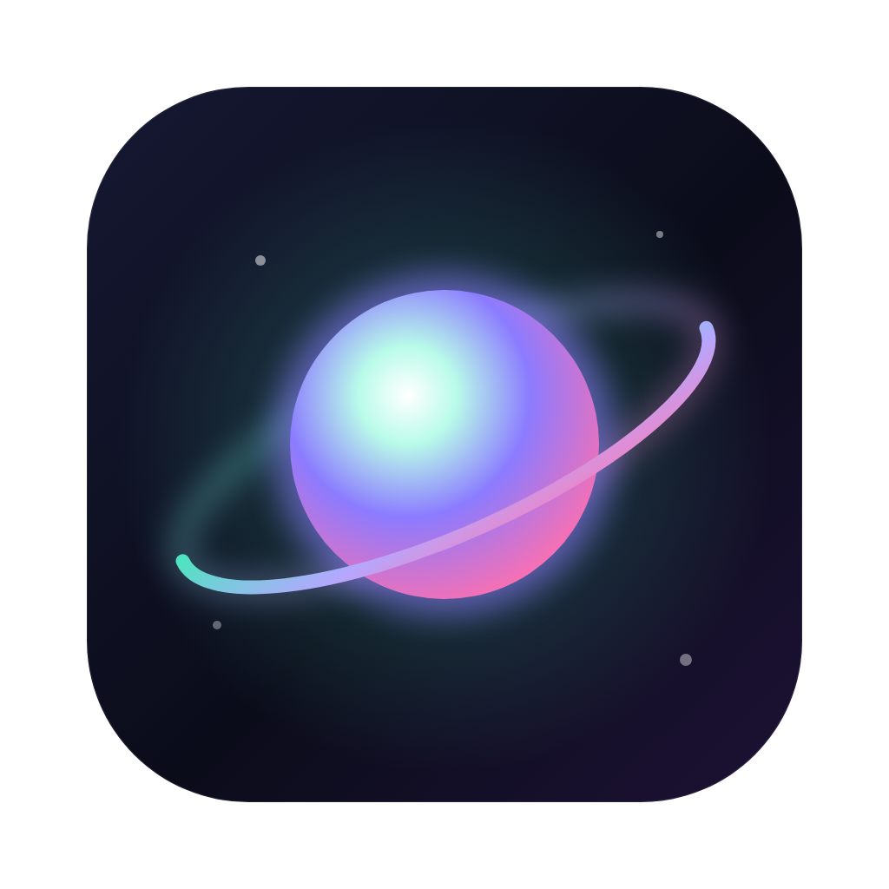
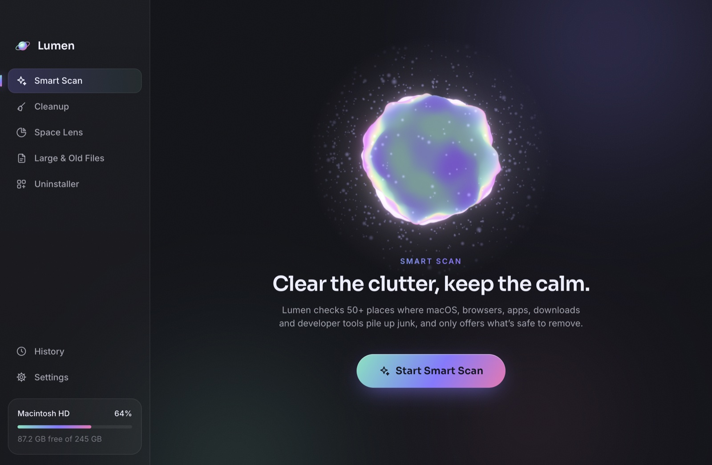
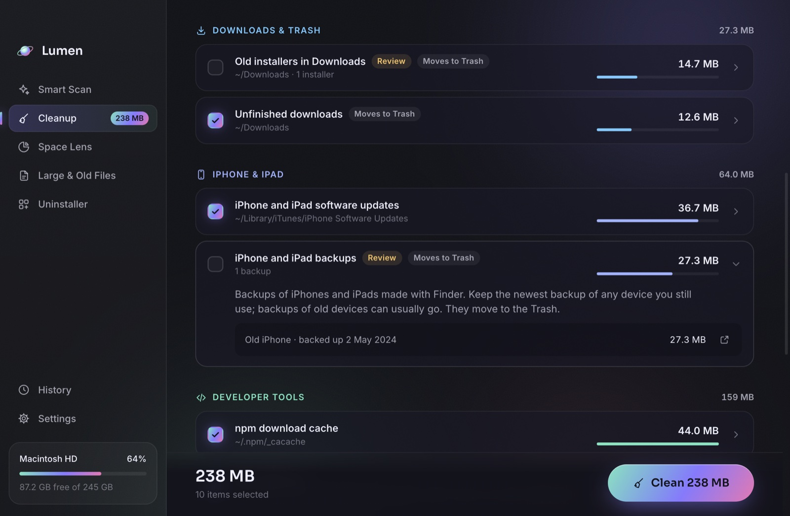
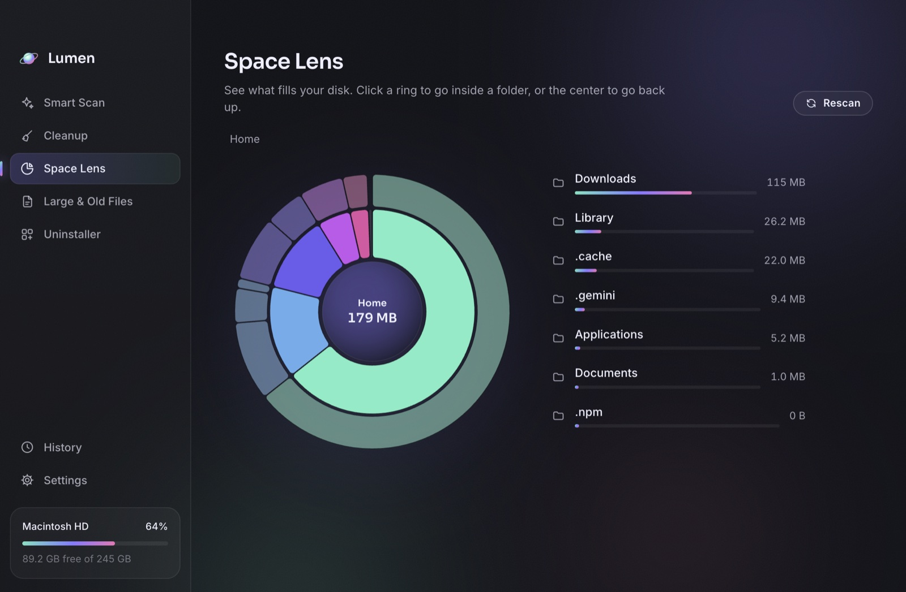
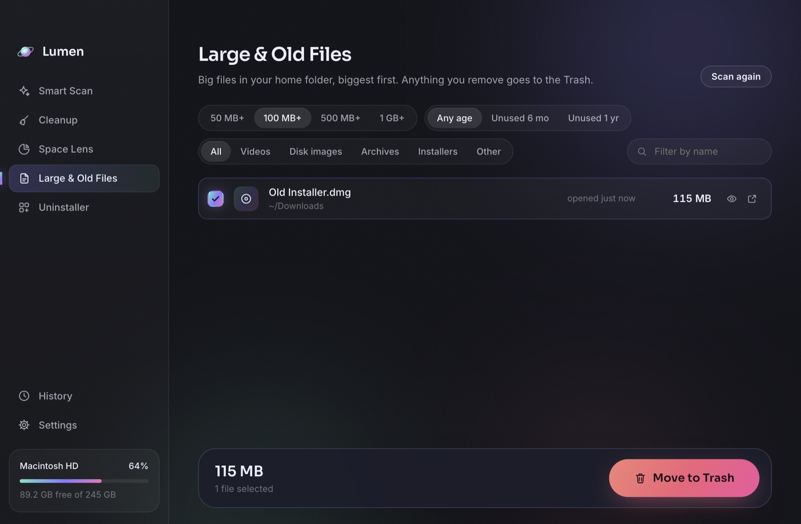
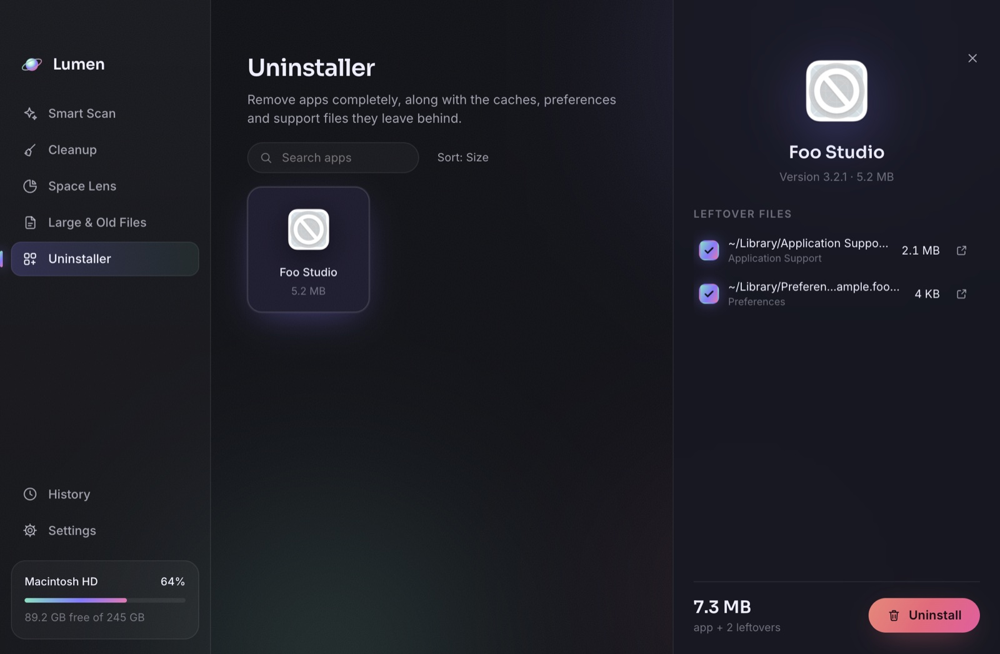

<p align="center">
  
</p>

<h1 align="center">Lumen</h1>

<p align="center">
  <strong>A calm, thorough, open-source cleaner for every Mac, with extra care for developers.</strong><br />
  Clears browser and app caches, forgotten installers, old iPhone backups and leftovers from deleted apps, plus the package caches, simulators and model downloads that other cleaners miss.
</p>

<p align="center">
  <a href="https://github.com/sabbirrifat/lumen/actions/workflows/ci.yml"></a>
  <a href="https://github.com/sabbirrifat/lumen/releases/latest"></a>
  <a href="LICENSE"></a>
  
  <a href="CONTRIBUTING.md"></a>
</p>

<p align="center">
  
</p>

## Why Lumen

Every Mac slowly fills up with things nobody asked to keep:

- **Everyone:** browser and app caches, installers left in Downloads after the app was installed, downloads that never finished, backups of an iPhone you sold years ago, and data from apps you deleted long ago.
- **Developers** have it worse. Consumer cleaners stop at the basics, but the big wins hide elsewhere: 30 GB of npm downloads, 10 GB of Python wheels, ten old Chrome builds Puppeteer collected, a database log that has grown for a year, simulators from an Xcode you uninstalled.

Lumen knows where all of these live, measures them, explains each one in plain language, and only pre-selects what's safe. Your own files, like installers and backups, go to the Trash instead of being deleted. It is free, MIT-licensed, makes no network requests, and needs no account.

## Features

| | |
|---|---|
| **Smart Scan** | One click checks 51 known locations in seconds, with live progress and a 3D orb that reacts as it works. |
| **Cleanup** | Every finding is grouped, sized and explained. Safe items are ticked; anything that needs judgment is marked **Review**. |
| **Space Lens** | An interactive sunburst of your home folder. Click a ring to go inside, the center to go back up. |
| **Large & Old Files** | Big files you haven't opened in months, filtered by size, age and kind, with Quick Look. They go to the Trash, never straight to deletion. |
| **Uninstaller** | Removes an app along with the caches, preferences and support files it leaves in `~/Library`. |
| **History** | A record of everything Lumen cleaned and how much space it freed. |

<p align="center">
  
  
  
  
</p>

## What Lumen cleans

Items marked ✓ are pre-selected after a scan. **Review** items are listed but left for you to decide. 🗑 means the files move to the Trash instead of being deleted.

| Category | What | Default |
|---|---|---|
| **System junk** | Application caches in `~/Library/Caches` (skips apps that are running) · app logs · crash reports | ✓ |
| | Leftovers from deleted apps: containers, saved state and web data of apps that are no longer installed 🗑 | Review |
| **Browsers & apps** | Safari, Chrome, Firefox, Edge, Brave, Arc and Vivaldi caches (never cookies, history, passwords or tabs) | ✓ |
| | Slack, Microsoft Teams, Discord, Notion, Figma, Obsidian, VS Code, Cursor and Windsurf caches | ✓ |
| | Copies of attachments you opened in Mail (the originals stay in your mailbox) | Review |
| **Downloads & Trash** | Downloads that stopped partway 🗑 | ✓ |
| | Installers (`.dmg`, `.pkg`) in Downloads older than a week 🗑 · Trash | Review |
| **iPhone & iPad** | Software updates Finder downloaded | ✓ |
| | Device backups, labelled with the device name and date 🗑 | Review |
| **Developer tools** | npm · pnpm · Yarn · pip · uv (keeps environments a running tool uses) · node-gyp · TypeScript · CocoaPods · Gradle · Homebrew | ✓ |
| | Old Puppeteer and Playwright browsers (keeps the newest of each) | ✓ |
| | MongoDB log (emptied in place, safe while it runs) · Homebrew service logs | ✓ |
| | Xcode DerivedData · simulator caches | ✓ |
| | Old Node.js versions from nvm · `node_modules` in projects untouched for 60+ days · Docker build cache and dangling images · Xcode device support files and archives · simulator devices | Review |
| **AI tools** | Hugging Face models (keeps your login token) · Ollama models · Antigravity data | Review |

Safari, Mail, iPhone backups and the Trash are protected by macOS: Lumen can only see them once you give it Full Disk Access.

Every rule lives in [`src/main/engine/rules`](src/main/engine/rules). Adding one is a great first contribution: see [CONTRIBUTING.md](CONTRIBUTING.md#adding-a-cleanup-rule).

## Safety first

Deleting files is the one thing a cleaner must never get wrong, so Lumen is built defensively and the rules below are covered by tests:

- **Every deletion is checked by a guard.** A path must sit strictly inside the folders its rule declared. It can never be your home folder or anything above it, never inside Documents, Desktop, Pictures, Movies, Music, iCloud Drive, Mail, Messages or Keychains, and never reached through a symlink that points elsewhere.
- **Apps are left alone while they run.** If Chrome is open, Lumen tells you to quit it instead of pulling its cache out from under it.
- **Your own files go to the Trash.** Installers, device backups, leftovers of deleted apps, large files, Space Lens items and uninstalled apps are moved to the Trash, so you can put them back. Only caches and logs that apps rebuild are deleted outright.
- **Leftovers are judged conservatively.** Data counts as a leftover only when no installed app from the same developer remains, and Apple's own data is never included.
- **Each rule is re-checked right before cleaning**, in case something changed since the scan.
- **Nothing leaves your Mac.** Lumen makes no network requests and collects no data.

Lumen is provided as-is, without warranty (see [LICENSE](LICENSE)). Review what you clean, especially items marked Review.

## Install

1. Download the latest `Lumen-x.y.z-arm64.dmg` from [Releases](https://github.com/sabbirrifat/lumen/releases/latest).
2. Open it and drag **Lumen** into **Applications**.
3. The first time you open it, macOS will block it because Lumen isn't notarized (that needs a paid Apple Developer account). Go to **System Settings → Privacy & Security** and click **Open Anyway**. Or run:

   ```bash
   xattr -dr com.apple.quarantine /Applications/Lumen.app
   ```

4. Recommended: give Lumen **Full Disk Access** (System Settings → Privacy & Security → Full Disk Access), then reopen it, so it can also clean Safari, Mail attachments, iPhone backups and the Trash. The first launch walks you through it.

Requires macOS 13 Ventura or later on Apple silicon. Intel Macs can [build from source](#build-from-source) for now; an Intel/universal build is a welcome contribution.

## Build from source

You need [Node.js](https://nodejs.org) 24 and npm.

```bash
git clone https://github.com/sabbirrifat/lumen.git
cd lumen
npm ci
npm run dev        # run with hot reload
npm run build:mac  # build dist/mac-arm64/Lumen.app and a DMG
```

## Development

| Command | What it does |
|---|---|
| `npm run dev` | Run the app with hot reload |
| `npm test` | Engine tests (Vitest) on generated fake home folders. Never touches your real files |
| `npm run test:e2e` | Builds the app, launches it against a fixture home, scans, cleans and screenshots every page |
| `npm run dry-run` | Scans your real home folder and prints what each rule would free. Read-only |
| `npm run typecheck` / `npm run lint` | Both must pass before a PR |
| `npm run build:mac` | Unsigned arm64 `.app` and DMG in `dist/` |

**Stack:** Electron, React 19, TypeScript, electron-vite, Zustand, Motion, React Three Fiber with a custom GLSL shader, and the Web Audio API for sounds (synthesized, no audio files).

```
src/
├── shared/types.ts      IPC contract shared by every process
├── main/
│   ├── engine/          Pure Node: rules, scanner, cleaner, guard, Space Lens, uninstaller
│   └── ipc.ts           Where the engine meets Electron
├── preload/             Exposes a typed window.lumen API
└── renderer/src/        React UI: pages, components, 3D orb, sounds
```

## Contributing

Contributions of every size are welcome: a new cleanup rule, a bug report, a design idea, or a typo fix. Start with [CONTRIBUTING.md](CONTRIBUTING.md), then look at the [good first issues](https://github.com/sabbirrifat/lumen/labels/good%20first%20issue). Questions and ideas go in [Discussions](https://github.com/sabbirrifat/lumen/discussions).

Please read the [Code of Conduct](CODE_OF_CONDUCT.md). To report a security problem, follow [SECURITY.md](SECURITY.md) instead of opening a public issue.

## Acknowledgements

- 3D simplex noise by Ian McEwan and Ashima Arts ([webgl-noise](https://github.com/ashima/webgl-noise), MIT)
- [Inter](https://fonts.google.com/specimen/Inter) and [Sora](https://fonts.google.com/specimen/Sora) typefaces (SIL Open Font License)

## License

[MIT](LICENSE) © 2026 Sabbir Rifat and Lumen contributors. Free to use, modify and share.
